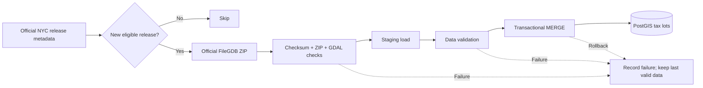

<div align="center">

# 🏙️ NYC Housing Intelligence Platform

**Turning fragmented NYC housing records into reliable, understandable building-level information.**

[](https://www.python.org/)
[](https://www.postgresql.org/)
[](https://postgis.net/)
[](https://gdal.org/)
[](https://pytest.org/)


**Backend & data engineering project · Built by [Muhammad Yassa](https://github.com/MuhammadYassa)**

</div>

---

## Overview

New York City publishes extensive housing data, but useful information about a property is scattered across agencies, datasets, and identifiers. A renter should not need to understand tax lots, permit schemas, and agency-specific address formats to investigate a building.

**NYC Housing Intelligence** aims to bring those records together into searchable, source-backed building profiles, with clear historical context and an AI assistant grounded in verified facts and official guidance.

## Project status

| Component | Status | What that means |
| --- | --- | --- |
| PostgreSQL/PostGIS database and Alembic migrations | ✅ Implemented | Schemas, canonical tax-lot storage, spatial indexing, and import-run lineage |
| MapPLUTO archive ingestion | ✅ Implemented | GDAL inspection, staging, validation, and transactional merge into `silver.tax_lots` |
| Autonomous MapPLUTO acquisition | ✅ Implemented | Release discovery, official-source ZIP acquisition, integrity checks, quality gates, and orchestration |
| Import reliability and recovery | ✅ Implemented | Idempotent re-imports, locking, rollback, failure reporting, and interrupted-run recovery |
| Daily scheduled execution | 🗓️ Not activated | The automation command and cron example exist; no always-on schedule has been deployed |
| Additional datasets: HPD, DOB, 311, DOF, ACS | 🔜 Planned | Data connectors, validation contracts, and canonical ingestion |
| Address ↔ BBL/BIN building resolution | 🔜 Planned | Connect agency records and user-entered addresses to the correct properties |
| Building profiles, API, and web client | 🔜 Planned | FastAPI endpoints and React-based renter experience |
| Grounded AI assistant | 🔜 Planned | Source-aware explanations based on deterministic facts and official NYC guidance |

## What I've implemented

### 1. Autonomous MapPLUTO acquisition

The pipeline checks for new MapPLUTO releases and processes valid source artifacts without requiring a person to manually fetch the ZIP file.

- **Lightweight release discovery:** queries official NYC Department of City Planning ArcGIS service metadata for the release version, edit timestamp, and feature count.
- **Official-source enforcement:** locates the original **shoreline-clipped File Geodatabase ZIP** published by NYC Planning and checks its provenance instead of silently substituting third-party files or ArcGIS exports.
- **Artifact integrity:** stores release-specific source files under `data/bronze/mappluto/{version}/`, calculates SHA-256 checksums, and validates the ZIP before ingestion.
- **Source compatibility:** uses GDAL to verify the expected layer, schema, geometry type, feature counts, and **EPSG:2263** coordinate reference system.
- **Quality safeguards:** checks staging completeness and cross-release total and borough row counts before promoting a new snapshot.
- **Repeat-run behavior:** logs unchanged publications and previously imported artifacts without creating import runs. Transient HTTP operations have three attempts per invocation; ingestion failures can be retried on a later run.

The acquisition stage uses the existing, separately tested MapPLUTO ingestion path rather than writing directly to canonical tables.

### 2. Transactional MapPLUTO ETL

The pipeline processes geospatial records in **PostgreSQL 17 + PostGIS 3.5** using an explicit staging-to-canonical flow:



- **Staging first:** `ogr2ogr` loads the source into `staging.mappluto_source`; the canonical dataset is not updated until validation succeeds.
- **Set-based merge:** valid rows are normalized and merged into `silver.tax_lots`, tracking inserted, updated, and unchanged records.
- **Idempotency:** importing an identical release again produces **0 duplicate records and 0 unnecessary updates** in repeat-run verification.
- **Safe concurrency:** PostgreSQL advisory locking prevents overlapping MapPLUTO jobs from competing for shared staging resources.
- **Failure safety:** validation or merge failures roll back canonical changes; abandoned imports are marked failed on a subsequent run. Uncertain GDAL termination requires manual clearance.
- **Lineage:** `etl.import_runs` records the release, source checksum, lifecycle state, row counts, outcomes, and failure diagnostics.

### 3. Verified processing and testing

| Metric | Verified project milestone |
| --- | --- |
| MapPLUTO snapshot processed | **856,614 NYC tax-lot records** |
| Snapshot release | **26v1** |
| Repeat-run results | **0 duplicates; 0 unnecessary updates** |
| Automated tests in the last reported local run | **198 passed** |
| Integration tests included in that run | **61** |

The **856,614** figure describes the successfully processed **26v1 snapshot**, not a claim that the most recent NYC release has the same count. Likewise, the test totals describe a local verification milestone—not a continuously updated CI badge.

Tests exercise source validation, source-file handling, database behavior, transactional merging, concurrency, and failure scenarios. Integration tests require a PostgreSQL/PostGIS environment with permission to create a disposable test database.

## Tech stack

| Layer | Technologies |
| --- | --- |
| Language | Python 3.12+ |
| Database | PostgreSQL 17, PostGIS 3.5 |
| Data access and migrations | SQLAlchemy, psycopg 3, Alembic |
| Geospatial ingestion | GDAL (`ogrinfo`, `ogr2ogr`), FileGDB |
| Configuration and testing | Pydantic Settings, pytest |
| Local infrastructure | Docker Compose |
| Planned application layer | FastAPI, React/TypeScript |
| Planned AI | Model API integration, deterministic domain tools, source-grounded retrieval |

## Getting started

These instructions run the **database and ingestion foundation**, not a web application. The autonomous entry point below becomes available when the accompanying acquisition changes are pushed.

### Prerequisites

- **Python 3.12+**
- **Docker + Docker Compose**
- **GDAL 3.7+**, with the **OpenFileGDB** and **PostgreSQL** drivers available (`ogrinfo` and `ogr2ogr`)
- Sufficient local disk space for a MapPLUTO archive, extracted geodatabase, and PostgreSQL data

### 1. Clone and install

```bash
git clone https://github.com/MuhammadYassa/nyc-housing-intelligence.git
cd nyc-housing-intelligence

python -m venv .venv
# Activate the virtual environment for your shell, then:
python -m pip install -e ".[dev]"
```

### 2. Configure and start PostgreSQL

Use a fresh PostgreSQL volume. Copy `.env.example` to `.env` only if you do not already have one, then set `POSTGRES_PASSWORD`, GDAL executable paths, and both MapPLUTO count-change thresholds. Do **not** commit `.env` or credentials.

```bash
docker compose up -d --wait postgres
alembic upgrade head
```

Ensure the configured `ogrinfo` and `ogr2ogr` commands are on your `PATH` (or point the executable settings to their installed paths).

### 3. Run autonomous acquisition and ingestion

```bash
python -m housing_intelligence.pipeline.mappluto.automation
```

This is the automation entry point developed for release discovery, download, validation, and ingestion. Run it manually as needed, or configure an external scheduler after verifying the environment. **A daily cron schedule is not deployed or enabled by this repository.**

For troubleshooting or reproducing an import from an archive you already trust, the underlying archive-based job also supports:

```bash
python -m housing_intelligence.pipeline.mappluto.job \
  --archive /path/to/official-mappluto.zip \
  --release 26v1 \
  --sha256 YOUR_EXPECTED_SHA256
```

Use the actual release identifier, archive location, and checksum; supported source contracts are defined in code. The example above illustrates the existing **26v1** archive-ingestion interface, not an instruction to force old data as the latest release.

Configure `MAPPLUTO_MAX_TOTAL_CHANGE` and `MAPPLUTO_MAX_BOROUGH_CHANGE` explicitly
before automated imports. Both are fractional limits (for example, 0.10 means
10%); choose them after reviewing acceptable source changes. All five boroughs
must be present. Use `--force-download` to check for replacement bytes when
published metadata is unchanged.

The first automated import needs no historical baseline: it validates the source
and staging rows, requires all five boroughs, then saves total and borough counts
with the successful merge. Later automated imports compare against the last
successful source. No baseline reconstruction step is needed. Reviewed manual
archive imports remain available and also save counts for later automation.

### 4. Run tests

The default command runs the non-integration suite; database integration tests are opt-in:

```bash
pytest -q
```

Run the **full suite, including PostgreSQL/PostGIS integration tests**, with:

```bash
pytest -q --integration
```

Integration tests create and drop their own **disposable test database**. Run them only against an appropriate local PostgreSQL instance with `CREATE DATABASE` permission, never a production database. The 198-pass milestone above refers to a full local run with integration tests enabled.

## Repository layout

```text
nyc-housing-intelligence/
├── alembic/                         # Versioned database migrations
├── data/                            # Source and working-data directories
├── docs/                            # Source audits and data contracts
├── src/housing_intelligence/
│   ├── pipeline/
│   │   ├── import_runs.py            # Ingestion lifecycle and lineage
│   │   └── mappluto/
│   │       ├── automation.py         # Autonomous pipeline entry point
│   │       ├── discovery.py          # Official release discovery
│   │       ├── acquisition.py        # Archive acquisition and checks
│   │       ├── quality.py            # Cross-release quality controls
│   │       ├── job.py                # Transactional archive ingestion
│   │       └── ...                   # GDAL, validation, merge, contracts
│   └── ...
├── tests/                            # Unit and PostgreSQL integration tests
├── compose.yaml                      # Local PostgreSQL/PostGIS
├── .env.example                      # Safe configuration example
└── pyproject.toml                    # Python package, tooling, dependencies
```

*The automation modules listed above are part of the upcoming combined code-and-README push.*

## Roadmap

The next work is organized as small, independently testable features rather than attempting to build the entire product at once.

### Phase 1 — Data foundation ✅

- [x] PostgreSQL/PostGIS schema, migration, and import-run foundation
- [x] Validate and ingest MapPLUTO tax-lot snapshots
- [x] Idempotent, transactional staging-to-canonical merge
- [x] Implement autonomous official MapPLUTO release discovery and acquisition
- [x] Add failure recovery, integrity validation, and automated tests
- [ ] Activate and monitor a recurring production schedule

### Phase 2 — Multi-source housing data ⏳

- [ ] Ingest HPD violations and complaints using validated incremental loads
- [ ] Add DOB permit/activity data and relevant 311 complaints
- [ ] Incorporate DOF property/tax data and ACS neighborhood context
- [ ] Build a reliable address ↔ **BBL/BIN** resolver across agency datasets
- [ ] Preserve dataset freshness, provenance, and historical reporting context

### Phase 3 — Renter-facing platform ⏳

- [ ] Build FastAPI address search and property-profile endpoints
- [ ] Create a lightweight React/TypeScript interface
- [ ] Show violations, complaint timelines, permit history, and source links
- [ ] Add understandable comparisons and transparent indicators
- [ ] Deploy and monitor the application with Docker Compose

### Phase 4 — Grounded AI assistant ⏳

- [ ] Answer building questions using **deterministic, verified application data**
- [ ] Retrieve relevant **official NYC tenant guidance**, with visible source attribution
- [ ] Separate sourced facts from model-generated interpretation
- [ ] Introduce bounded tool execution, timeouts, retries, and concurrency limits
- [ ] Evaluate factual accuracy, citations, and failure handling before release

## Design principles

**Data correctness before features.** Public datasets can contain missing fields, corrections, schema changes, and inconsistent building identifiers. New data must pass explicit checks before it can affect a property profile.

**One authoritative database.** PostgreSQL/PostGIS stores structured records and their source lineage. Batch ingestion runs separately from request handling; a distributed/streaming architecture is unnecessary for this project's update cadence.

**Evidence before AI.** The planned assistant will not generate property facts from memory or invent SQL as a substitute for application logic. It will work with verified building facts and retrieved guidance, preserve citations, and communicate uncertainty.

## Data sources and limitations

- [NYC Department of City Planning — MapPLUTO / PLUTO](https://www.nyc.gov/content/planning/pages/resources/datasets/mappluto-pluto-change) — **implemented** source for land-use and tax-lot records
- [NYC Open Data](https://opendata.cityofnewyork.us/) — planned source portal for additional housing, complaint, and building datasets
- Official NYC tenant and housing guidance — **planned** retrieval source for the AI assistant

This is an independent educational and engineering project, **not affiliated with or endorsed by NYC agencies**. Public records can be delayed, incomplete, corrected, or reported at different levels (tax lot, building, complaint, or address). Future property insights will be presented as informational evidence, not definitive judgments or legal advice.

---

<div align="center">

**Built by [Muhammad Yassa](https://github.com/MuhammadYassa)** · [LinkedIn](https://www.linkedin.com/in/muhammadyassa/)

*Reliable data first. Useful answers next.*

</div>
